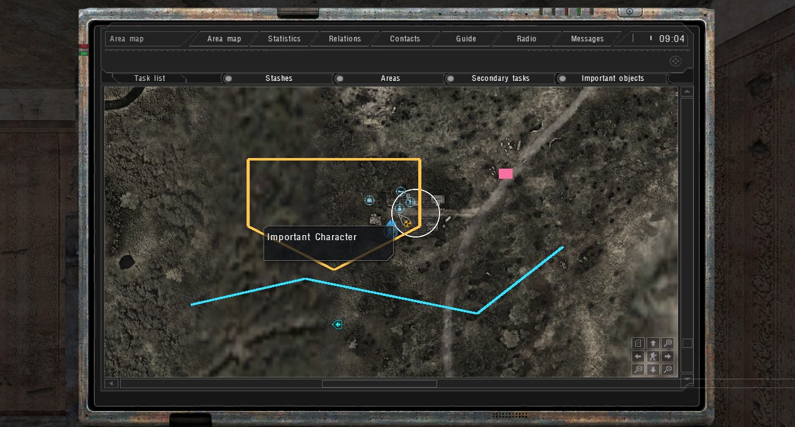
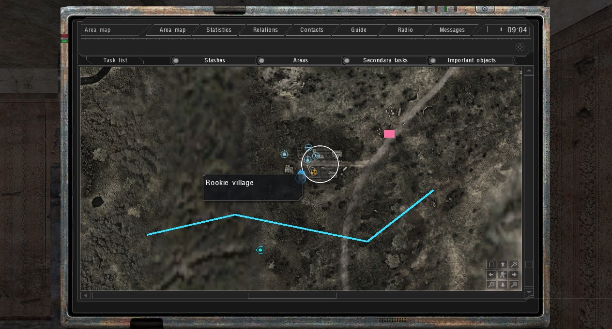
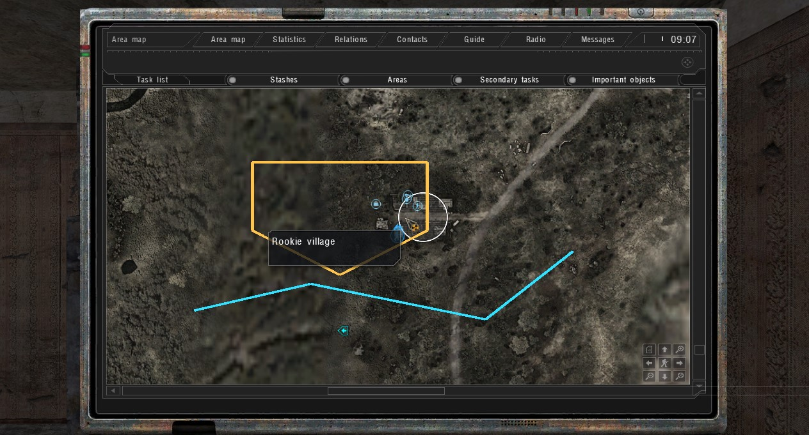

# R1 PDA Map API validation

Date: 2026-10-12. Native checks used isolated Anomaly 1.5.3 installations with the October 2026.10.11 runtime files. Engine/API changes are separate from the acceptance fixture; no pencil addon is activated by installing this source change.

## Source and full builds

| Variant | Upstream baseline | Tested engine source | Full build |
|---|---|---|---|
| Ordinary | `c57fe5b9fab4fe0506659db03137c52d2500eb2f`, tag `2026.10.11` | `70b9d8aa58258c8e58bf2d6107da737337df1c8a` | DX11 x64, exit 0 |
| MT | `871e2491228a64f0d5e257c7a7e0255feb841ac8` | `3aa0f22178241ee7a3c5344d6535c81a8a61161f` | DX11 x64, exit 0 |

Both used the complete upstream VS2022 solution, MSVC `14.44.35207` and Windows SDK `10.0.26100.0`. Each executable has its matching PDB. Later documentation/test-fixture changes do not modify these tested engine translation units.

Ordinary EXE SHA-256: `2047627590887e0895436de0ff79f120c0b777cd5e34bc94b104c25bb3f9c0a4`.
MT EXE SHA-256: `6f4f7cd8752841461c05f1cf891bebc7aa57168f23aa33af6718fabb82a46050`.

The changed translation units also compiled separately without PCH against each variant. The full builds retain upstream compiler/linker warnings; successful exit codes are not claims of warning-free source.

## Ordinary native acceptance: passed

Configuration: x64 DX11, 1280x720 windowed, 2D PDA (`g_3d_pda off`), Cordon (`l01_escape`). The game rendered on a separate inactive desktop and captured its own screenshots. Mouse/keyboard automation was not used for this acceptance run. **66 native assertions passed.**

- `pda_map` v1 is registered and ready on the actual game map.
- Two unique addon-owned layers; duplicate owner refused.
- Closed polyline, open route and UI-atlas marker rendered over the map.
- Invalid texture, malformed points, unknown map and NaN rejected.
- Live global-map and level X/Z projection round-trips passed.
- Exclusive input owner acquired; a second acquisition and foreign release refused.
- Clearing the first layer preserved the route and marker in the second layer.
- Layer visibility toggled; closing the PDA refused input and released its previous owner; reopening allowed ownership transfer. Visibility callbacks fired.
- The fixture saved plain Lua coordinates/styles, exited, and a fresh process cold-loaded that save. Old handles were invalid before registration; two polylines were reconstructed with new layers and rendered. The marker was deliberately not serialized by this fixture.
- Restored layers released successfully. Both processes exited 0. Original EXE/PDB, game configuration, gamedata and appdata hashes were restored; temporary files/processes/desktops were removed and the test room released.

## MT acceptance: incomplete

Native initial drawing, coordinate conversion, layer independence, visibility and input ownership passed with `mt_ui 1` and `mt_ui 0`. These are partial results. The `mt_ui 1` cold-load process exited with `0xC0000374` before its first actor update/API drawing calls. A separate `mt_ui 0` run exited with `0xC0000005` during renderer shutdown after saving. An unmodified October MT control EXE (SHA-256 `c9c7147e50f540799234548c1a00d1f4c34c7b358d7df8db9f89c4eb4068643c`) also failed to complete the background control run, timing out after its first actor update without calling `pda_map`. This does not prove the native failures have the same cause or establish an upstream defect. MT is an experimental source port, not a successfully accepted runtime variant; its PR is a draft.

## Additional checks and limits

- `tests/R1_Run_PdaMapMath.ps1`: **308 checks passed**, exercising the production transform/quad header across origins, bounds, aspect factors, zoom/pan, invalid inputs and degenerate dots.
- Bundled Lua 5.1 parser accepted the modified callback/help scripts and opt-in example. Project XML, source registration, UTF-8/line endings and `git diff --check` passed.
- A same-process background QuickLoad reached its first actor update but did not complete the precache phase before timeout. This does not establish foreground QuickLoad acceptance or identify an API regression.
- Physical freehand strokes/consumption, zoom/pan/nav/context-menu interaction, viewport-edge runtime clipping, 3D PDA, death/level transitions, other renderers/AVX, modpacks, resource-limit stress and performance remain pending. Individual button/key callbacks were observed in an earlier visible run; a full manual stroke was not accepted.

## Reproduce the isolated native fixture

`tests/R1_Pda_Map_Runtime_Test.script` is opt-in test code outside `gamedata/scripts`. Copy it only into a disposable game/test profile with this engine and its updated callback definitions. It enables god mode and 2D PDA, opens the map, draws fixtures, clears a layer, checks ownership, then saves `R1_Pda_API_Verified` and quits. Restart that isolated game with this save and the fixture still installed; it rebuilds the saved polylines, records `RELOAD_COMPLETE`/`COMPLETE` and quits. Inspect `[R1PDATEST] PASS` output and delayed renderer screenshots. Remove the fixture and restore test settings afterward.

The old handles stored by this fixture are negative-test data only. Production addons must never persist native handles. Persistence remains addon-side; the engine adds no annotation save format.

RU: обычная DX11/2D сборка прошла рисование, независимость слоёв, владение вводом и восстановление Lua-рисунков после полного перезапуска. Обе ветки полностью собраны, но приёмка MT не завершена из-за нативных сбоев. Физическая мышь, 3D КПК, остальные рендереры и производительность не подтверждены.
